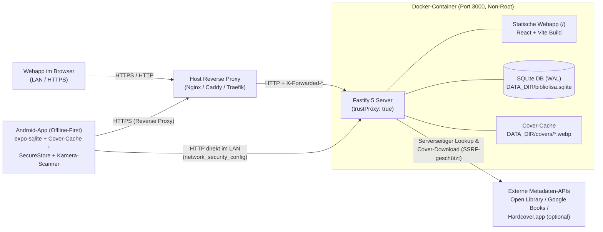
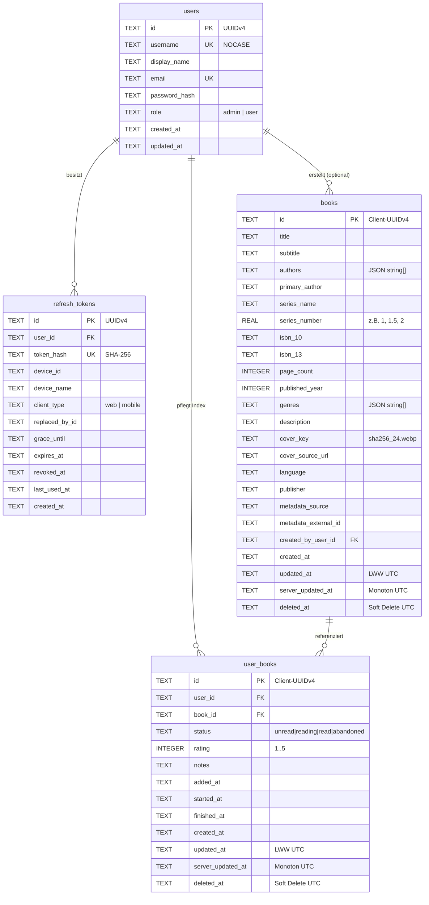
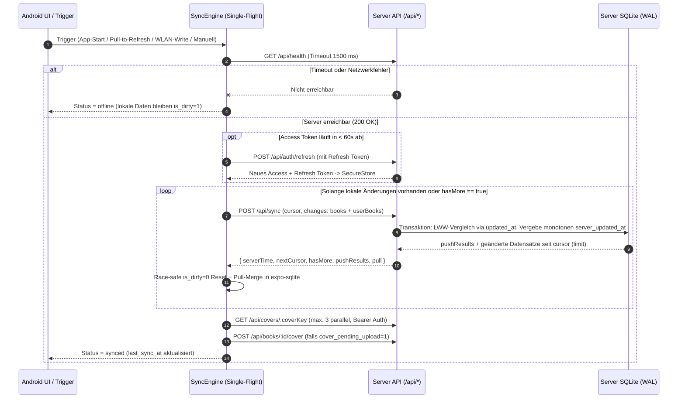

# Bibliolisa – Architektur & Technische Spezifikation

> **Status:** Verbindliche Referenzspezifikation (Single Source of Truth gemäß `.antigravity/rules.md`)  
> **Zielplattformen:** Selbstgehosteter LAN-Docker-Container (Fastify API + React Webapp) & Offline-First Android-App (React Native / Expo)

---

## 1. Projektübersicht, Ziele & Architekturprinzipien

**Bibliolisa** ist eine selbstgehostete Bücher-Indexierungs-Plattform für den Betrieb im lokalen Netzwerk (LAN) oder hinter einem bestehenden Reverse Proxy. Jeder Benutzer verwaltet genau einen eigenen, strikt isolierten Bücher-Index (Lesestatus, persönliche Bewertung, Notizen, Hinzufügedatum), während bibliographische Buch-Metadaten und gecachte Cover zentral in einer gemeinsamen `books`-Tabelle liegen und offline-fähig auf Android-Geräte synchronisiert werden.

### 1.1 Technologie-Stack

| Bereich | Technologie / Bibliothek | Rolle im Gesamtsystem |
| :--- | :--- | :--- |
| **Monorepo** | `pnpm` Workspaces, Node.js 22 LTS, TypeScript (`strict: true`) | Einheitliche Paketverwaltung, strikte Typensicherheit über alle Pakete |
| **Shared (`/shared`)** | `@bibliolisa/shared`, Zod, reine TypeScript-Module, Vitest | Single Source of Truth für DTOs, Zod-Schemas, Sync-Contracts, ISBN-Utilities, Sortier-Logik und die reine Empfehlungs-Engine |
| **Backend (`/server`)** | Node.js 22, Fastify 5 (`trustProxy: true`), `better-sqlite3` (WAL-Mode), Drizzle ORM (`drizzle-orm`, `drizzle-kit`), `sharp`, `@fastify/cookie`, `@fastify/rate-limit`, `@fastify/multipart`, `@fastify/static`, Vitest | REST-API unter `/api/*`, Auth/Sessions, Delta-Sync, Metadaten-Provider-Aggregation, SSRF-sicherer Cover-Cache, Auslieferung der Webapp unter `/` |
| **Webapp (`/web`)** | React 19, Vite, TypeScript, Tailwind CSS, shadcn/ui, TanStack Query, React Router | Verwaltungs-, Lese-, Such-, Empfehlungs- und Backup-Oberfläche (JSON/CSV-Export & JSON-Import) |
| **Android (`/mobile`)** | React Native (Expo SDK 52+, TypeScript), `expo-sqlite`, `expo-secure-store`, `expo-camera`, `expo-file-system`, `expo-network` | Vollständige Offline-First-App mit lokalem SQLite, lokalem Cover-Cache, Kamera-ISBN-Scanner, konfigurierbarer Server-URL und Delta-Sync |

### 1.2 System-Überblick



### 1.3 Unveränderliche Leitplanken (aus `.antigravity/rules.md`)

1. **Keine duplizierten DTOs:** Alle geteilten Domain-Typen, Zod-Validierungen und Sync-Contracts leben ausschließlich in `/shared`.
2. **Strikt getrenntes Datenmodell:** Globale Buchdaten (`books`) und benutzerspezifische Bibliotheksdaten (`user_books`) sind sauber getrennt.
3. **Strikte Mandantentrennung (1 Index pro Benutzer):** Jede Query und jeder Sync-Zugriff auf `user_books` filtert serverseitig zwingend nach der aus dem Auth-Token stammenden `user_id`.
4. **Client-generierte UUIDv4:** Alle synchronisierbaren Entitäten (`books`, `user_books`) verwenden ausschließlich clientseitig erzeugte UUIDv4-IDs – keine Auto-Increment-IDs.
5. **Keine Hard Deletes bei Sync-Tabellen:** Löschungen setzen ausschließlich `deleted_at` (ISO-8601 UTC).
6. **Delta-Sync mit LWW:** Konfliktauflösung erfolgt pro Datensatz über `updated_at` (UTC, Last-Write-Wins); der Pull-Cursor nutzt einen serverseitigen monotonen Timestamp (`server_updated_at`).
7. **Auth-Schutz:** Alle API-Routen außer `GET /api/health` sowie `POST /api/auth/login`, `POST /api/auth/register` und `POST /api/auth/refresh` (validiert Refresh-Token selbst) verlangen ein gültiges Access Token.
8. **Ein-Container-Deployment ohne eigenen Proxy:** Webapp (`/`) und API (`/api/*`) laufen gemeinsam im selben Docker-Container hinter dem bestehenden Host-Reverse-Proxy; persistente Daten liegen ausschließlich unter `DATA_DIR` (Standard `/data`).
9. **Keine Secrets oder IPs im Code:** Alle Secrets (`JWT_SECRET`, optionale API-Keys) stammen aus `.env`; Server-URLs der Mobile-App stammen aus den lokalen App-Einstellungen.

---

## 2. Monorepo-Ordnerstruktur

```text
Bibliolisa/
├── .antigravity/
│   └── rules.md                        # Verbindliche Projektregeln
├── .dockerignore
├── .env.example                        # Vorlage aller Server-Umgebungsvariablen
├── .gitignore
├── docker-compose.yml                  # Einzelcontainer-Setup mit /data-Volume
├── Dockerfile                          # Multi-Stage-Build (shared -> web & server -> runtime)
├── package.json                        # Root-Skripte (build, test, lint, typecheck)
├── pnpm-workspace.yaml                 # Workspaces: shared, server, web, mobile
├── tsconfig.base.json                  # Gemeinsame strikte TypeScript-Basis-Konfiguration
├── docs/
│   ├── ARCHITECTURE.md                 # Diese technische Spezifikation
│   └── ROADMAP.md                      # Phasenplan, Checklisten & Abnahmekriterien
│
├── shared/                             # @bibliolisa/shared
│   ├── package.json
│   ├── tsconfig.json
│   ├── src/
│   │   ├── index.ts                    # Zentrale Re-Exports
│   │   ├── schemas/
│   │   │   ├── common.ts               # UUIDv4, ISO-UTC, ReadingStatus, Pagination
│   │   │   ├── auth.ts                 # Login, Register, TokenResponse, SessionInfo
│   │   │   ├── book.ts                 # BookSchema, BookInputSchema, SeriesNumber
│   │   │   ├── user-book.ts            # UserBookSchema, LibraryFilter & Sort-Optionen
│   │   │   ├── sync.ts                 # SyncRequestSchema, SyncResponseSchema, PushResult
│   │   │   ├── metadata.ts             # MetadataCandidateSchema, SearchResponseSchema
│   │   │   ├── recommendation.ts       # RecommendationResultSchema, Category/Reason-Typen
│   │   │   └── export.ts               # ExportPayloadSchema, ImportResultSchema
│   │   ├── utils/
│   │   │   ├── isbn.ts                 # ISBN-10/13 Normalisierung, Checksumme, Konvertierung
│   │   │   └── sort.ts                 # Deterministische Reihen-/Autor-/Titel-Comparatoren
│   │   └── recommendations/
│   │       └── engine.ts               # Reine, offline-fähige Empfehlungs-Engine
│   └── tests/
│       ├── isbn.test.ts
│       ├── sort.test.ts
│       └── recommendations.test.ts
│
├── server/                             # @bibliolisa/server
│   ├── package.json
│   ├── tsconfig.json
│   ├── drizzle.config.ts
│   ├── src/
│   │   ├── index.ts                    # Server-Bootstrap, Shutdown-Hook (WAL-Checkpoint)
│   │   ├── app.ts                      # Fastify-Instanzaufbau (trustProxy: true)
│   │   ├── config/
│   │   │   └── env.ts                  # Zod-validierte Umgebungsvariablen
│   │   ├── db/
│   │   │   ├── client.ts               # better-sqlite3 + PRAGMAs + Drizzle-Client
│   │   │   ├── schema.ts               # Drizzle SQLite-Schema (users, refresh_tokens, books, user_books)
│   │   │   ├── migrate.ts              # Automatisches Ausführen ausstehender Migrationen beim Start
│   │   │   └── migrations/             # Generierte SQL-Migrationen
│   │   ├── plugins/
│   │   │   ├── auth.ts                 # JWT-Verifizierung, Cookie-Support, onRequest-Guard
│   │   │   ├── static.ts               # @fastify/static für Webapp (/) + SPA-Fallback
│   │   │   └── error-handler.ts        # Einheitliches Fehlerformat & ZodError-Mapping
│   │   ├── routes/
│   │   │   ├── health.ts               # GET /api/health (öffentlich)
│   │   │   ├── auth.ts                 # /api/auth/*
│   │   │   ├── library.ts              # /api/library/*
│   │   │   ├── covers.ts               # /api/covers/* & /api/books/:bookId/cover*
│   │   │   ├── sync.ts                 # POST /api/sync
│   │   │   ├── metadata.ts             # /api/metadata/*
│   │   │   ├── recommendations.ts      # GET /api/recommendations
│   │   │   └── export.ts               # /api/export/* & /api/import/json
│   │   ├── services/
│   │   │   ├── auth.service.ts         # scrypt-Hashing, JWT, Refresh-Rotation + Grace-Window
│   │   │   ├── library.service.ts      # CRUD, Facetten, Sortierung/Filterung, Soft Delete
│   │   │   ├── sync.service.ts         # Atomarer Delta-Sync, LWW, monotoner Cursor
│   │   │   ├── cover.service.ts        # SSRF-Schutz, sharp -> WebP, SHA-256 Ablage
│   │   │   └── export.service.ts       # JSON/CSV-Export (BOM + Injection-Schutz) & Import
│   │   └── metadata/
│   │       ├── types.ts                # MetadataProvider-Interface
│   │       ├── aggregator.ts           # Parallele Abfrage, Field-Merge, 15m-TTL-Cache
│   │       ├── openlibrary.adapter.ts  # Open Library API Adapter
│   │       ├── google-books.adapter.ts # Google Books API Adapter
│   │       └── hardcover.adapter.ts    # Hardcover.app GraphQL Adapter (optional per API-Key)
│   └── tests/
│       ├── auth.test.ts
│       ├── library.test.ts
│       ├── sync.test.ts
│       ├── metadata.test.ts
│       ├── covers.test.ts
│       └── export.test.ts
│
├── web/                                # @bibliolisa/web
│   ├── package.json
│   ├── tsconfig.json
│   ├── vite.config.ts                  # Dev-Proxy /api -> localhost:3000
│   ├── index.html
│   └── src/
│       ├── main.tsx
│       ├── App.tsx
│       ├── api/                        # Typisierter Fetch-Client inkl. Silent Refresh
│       ├── auth/                       # AuthProvider, In-Memory Access Token, ProtectedRoute
│       ├── components/                 # shadcn/ui Basis + BookCard, BookForm, MetadataSearchDialog, RatingStars
│       ├── hooks/                      # TanStack Query Hooks (Library, Facets, Recommendations)
│       ├── lib/                        # Formatierung, Debounce, Status-Labels
│       └── pages/                      # LoginPage, LibraryPage, BookDetailPage, RecommendationsPage, BackupPage, SettingsPage
│
└── mobile/                             # @bibliolisa/mobile (Expo React Native)
    ├── package.json
    ├── tsconfig.json
    ├── app.json                        # Expo-Konfiguration + Config-Plugin-Registrierung
    ├── metro.config.js                 # pnpm-Monorepo: watchFolders & nodeModulesPaths für @bibliolisa/shared
    ├── plugins/
    │   └── withLanNetworkSecurity.js   # Expo Config Plugin für network_security_config.xml
    └── src/
        ├── App.tsx                     # Navigation, DB-Init, Auto-Sync-Listener
        ├── db/
        │   ├── client.ts               # expo-sqlite Initialisierung
        │   ├── migrations.ts           # Lokales SQLite-Schema (inkl. is_dirty & sync_state)
        │   └── library.repo.ts         # Offline-CRUD, lokale Suche/Filter/Sortierung
        ├── services/
        │   ├── secure-storage.ts       # expo-secure-store Wrapper für Tokens & Auth-Metadaten
        │   ├── api-client.ts           # Dynamische Server-URL, Bearer-Injection, Auto-Refresh
        │   └── cover-cache.ts          # Lokaler Cover-Cache unter documentDirectory/covers/
        ├── sync/
        │   ├── health-check.ts         # 1500ms AbortController-Check gegen /api/health
        │   ├── sync-engine.ts          # Single-Flight Mutex, Push/Pull-Loop, Cover-Sync
        │   └── sync-context.tsx        # Sichtbarer Sync-Status & automatische Trigger
        ├── components/
        │   ├── BarcodeScanner.tsx      # expo-camera EAN-13/ISBN-Scanner
        │   ├── SyncStatusBadge.tsx     # Status-Indikator im Header & Detail-Sheet
        │   └── BookForm.tsx            # Offline-fähiges Buchformular
        └── screens/
            ├── LibraryScreen.tsx       # Übersicht, Suche, Filter, Reihen-Sortierung, Pull-to-Refresh
            ├── BookDetailScreen.tsx    # Detailansicht, Status, Bewertung, Notizen, Soft-Delete
            ├── AddBookScreen.tsx       # Barcode-Scan, Online-Lookup + Offline-Fallback
            ├── RecommendationsScreen.tsx # Offline-Empfehlungen über @bibliolisa/shared
            └── SettingsScreen.tsx      # Server-URL, „Verbindung testen“, Login/Logout, Sync-Details
```

> **Hinweis zu `mobile/metro.config.js` im pnpm-Monorepo:** Da `pnpm` Abhängigkeiten über Symlinks in `.pnpm/` verknüpft und `@bibliolisa/shared` außerhalb von `/mobile` liegt, konfiguriert `metro.config.js` zwingend `watchFolders` (Monorepo-Root) sowie `resolver.nodeModulesPaths` (`mobile/node_modules` und `<root>/node_modules`) inklusive `resolver.unstable_enableSymlinks = true`.

---

## 3. Komplettes SQLite-Datenmodell (Server & Mobile)

### 3.1 Entity-Relationship-Diagramm (Server)



### 3.2 SQLite-Betriebsparameter (PRAGMAs)

Beim Öffnen der Datenbank (`DATA_DIR/bibliolisa.sqlite`) setzt `server/src/db/client.ts` zwingend:

```sql
PRAGMA journal_mode = WAL;
PRAGMA synchronous = NORMAL;
PRAGMA foreign_keys = ON;
PRAGMA busy_timeout = 5000;
```

Beim geordneten Herunterfahren des Servers (`SIGINT` / `SIGTERM`) führt der Shutdown-Hook folgenden Checkpoint aus, damit alle WAL-Frames sauber in die Hauptdatenbank geschrieben werden:

```sql
PRAGMA wal_checkpoint(TRUNCATE);
```

### 3.3 Vollständiges Server-SQLite-Schema (DDL / Drizzle-Referenz)

Alle Zeitstempel liegen im kanonischen Format `YYYY-MM-DDTHH:mm:ss.sssZ` (UTC mit 3 Millisekundenstellen) vor, damit lexikografische Vergleiche in SQL exakt der chronologischen Reihenfolge entsprechen.

```sql
-- 1. Benutzerkonten (nicht über Delta-Sync synchronisiert)
CREATE TABLE users (
    id TEXT PRIMARY KEY, -- UUIDv4
    username TEXT NOT NULL UNIQUE COLLATE NOCASE,
    display_name TEXT,
    email TEXT UNIQUE COLLATE NOCASE,
    password_hash TEXT NOT NULL,
    role TEXT NOT NULL DEFAULT 'user' CHECK (role IN ('admin', 'user')),
    created_at TEXT NOT NULL,
    updated_at TEXT NOT NULL
);

-- 2. Refresh-Tokens für Web-Cookies & langlebige Mobile-Sessions
CREATE TABLE refresh_tokens (
    id TEXT PRIMARY KEY, -- UUIDv4
    user_id TEXT NOT NULL REFERENCES users(id) ON DELETE CASCADE,
    token_hash TEXT NOT NULL UNIQUE, -- SHA-256 Hex des Opaque-Tokens
    device_id TEXT,
    device_name TEXT,
    client_type TEXT NOT NULL CHECK (client_type IN ('web', 'mobile')),
    replaced_by_id TEXT,
    grace_until TEXT, -- 30s Kulanzfenster bei Rotation
    expires_at TEXT NOT NULL,
    revoked_at TEXT,
    last_used_at TEXT,
    created_at TEXT NOT NULL
);

CREATE INDEX idx_refresh_tokens_user_id ON refresh_tokens(user_id);
CREATE INDEX idx_refresh_tokens_expires_at ON refresh_tokens(expires_at);

-- 3. Globale Buch-Metadaten (synchronisierbar, Client-UUIDv4, Soft Delete)
CREATE TABLE books (
    id TEXT PRIMARY KEY, -- Client-generierte UUIDv4
    title TEXT NOT NULL,
    subtitle TEXT,
    authors TEXT NOT NULL DEFAULT '[]', -- JSON-Array string[]
    primary_author TEXT, -- aus authors[0] normalisiert für schnelles Sortieren/Filtern
    series_name TEXT,
    series_number REAL, -- Dezimalzahl z.B. 1, 1.5, 2, 10
    isbn_10 TEXT, -- 10 Zeichen ohne Bindestriche
    isbn_13 TEXT, -- 13 Ziffern ohne Bindestriche
    page_count INTEGER CHECK (page_count IS NULL OR page_count > 0),
    published_year INTEGER CHECK (published_year IS NULL OR (published_year >= 1000 AND published_year <= 2100)),
    genres TEXT NOT NULL DEFAULT '[]', -- JSON-Array string[] für Genres & Tags
    description TEXT,
    cover_key TEXT, -- z.B. a3f9c012e4b8910d3f7a12bc.webp unter DATA_DIR/covers/
    cover_source_url TEXT,
    language TEXT, -- optional ISO-639-1 (z.B. 'de', 'en')
    publisher TEXT,
    metadata_source TEXT NOT NULL DEFAULT 'manual'
        CHECK (metadata_source IN ('manual', 'openlibrary', 'google_books', 'hardcover')),
    metadata_external_id TEXT,
    created_by_user_id TEXT REFERENCES users(id) ON DELETE SET NULL,
    created_at TEXT NOT NULL,
    updated_at TEXT NOT NULL, -- Logischer UTC-Timestamp für LWW
    server_updated_at TEXT NOT NULL, -- Monotoner Server-UTC-Timestamp für Sync-Pull
    deleted_at TEXT -- ISO-8601 UTC Soft Delete (im Normalbetrieb nicht durch User-Löschung gesetzt)
);

-- Bewusst NICHT UNIQUE auf ISBN, damit zwei Offline-Clients mit eigenen UUIDv4-IDs
-- dasselbe Buch erfassen und konfliktfrei synchronisieren können.
CREATE INDEX idx_books_isbn13 ON books(isbn_13);
CREATE INDEX idx_books_isbn10 ON books(isbn_10);
CREATE INDEX idx_books_series ON books(series_name, series_number);
CREATE INDEX idx_books_primary_author ON books(primary_author);
CREATE INDEX idx_books_server_updated_at ON books(server_updated_at, id);

-- 4. Persönlicher Benutzer-Index (strikt pro user_id, synchronisierbar, Soft Delete)
CREATE TABLE user_books (
    id TEXT PRIMARY KEY, -- Client-generierte UUIDv4
    user_id TEXT NOT NULL REFERENCES users(id) ON DELETE CASCADE,
    book_id TEXT NOT NULL REFERENCES books(id) ON DELETE RESTRICT,
    status TEXT NOT NULL DEFAULT 'unread'
        CHECK (status IN ('unread', 'reading', 'read', 'abandoned')),
    rating INTEGER CHECK (rating IS NULL OR (rating >= 1 AND rating <= 5)),
    notes TEXT,
    added_at TEXT NOT NULL, -- Hinzufügedatum (für Sortierung & „Staubfänger“)
    started_at TEXT,
    finished_at TEXT,
    created_at TEXT NOT NULL,
    updated_at TEXT NOT NULL, -- Logischer UTC-Timestamp für LWW
    server_updated_at TEXT NOT NULL, -- Monotoner Server-UTC-Timestamp für Sync-Pull
    deleted_at TEXT -- ISO-8601 UTC Soft Delete
);

-- Partieller Unique-Index: verhindert doppelte aktive Einträge pro User & Buch,
-- erlaubt aber sauberes Wiederhinzufügen nach einem Soft Delete.
CREATE UNIQUE INDEX idx_user_books_active_unique
    ON user_books(user_id, book_id)
    WHERE deleted_at IS NULL;

CREATE INDEX idx_user_books_user_status ON user_books(user_id, status);
CREATE INDEX idx_user_books_user_sync ON user_books(user_id, server_updated_at, id);
CREATE INDEX idx_user_books_user_added ON user_books(user_id, added_at);
```

> **Hinweis zur ISBN-Deduplizierung:** Bei Online-Anlage über `POST /api/library` prüft der Server optional anhand von `isbn_13` / `isbn_10`, ob ein passender Eintrag in `books` bereits existiert, und verknüpft bevorzugt die vorhandene `book_id`. Beim Offline-Sync hingegen darf kein `UNIQUE`-Constraint auf ISBNs den Push zweier offline erzeugter Datensätze abbrechen – daher sind `idx_books_isbn13` und `idx_books_isbn10` nicht-eindeutige Suchindizes.

### 3.4 Sortierung, Filterung & Volltextsuche

1. **Buchreihen-Sortierung (`sort=series`):**
   ```sql
   ORDER BY
     (b.series_name IS NULL) ASC,
     LOWER(b.series_name) ASC,
     (b.series_number IS NULL) ASC,
     b.series_number ASC,
     LOWER(b.title) ASC
   ```
   Durch `series_number REAL` wird garantiert, dass Bände in der Reihenfolge `1`, `1.5`, `2`, `10` (und nicht lexikografisch `1, 10, 1.5, 2`) sortiert werden und Einzelbände ohne Reihe stets am Listenende erscheinen. Bei `order=desc` werden die Haupt-Sortierkriterien umgekehrt, während `NULL`-Werte konsistent am Ende verbleiben.

2. **Weitere Sortiermodi:**
   - **Autor (`author`):** `(b.primary_author IS NULL) ASC, LOWER(b.primary_author) ASC, LOWER(b.title) ASC`
   - **Titel (`title`):** `LOWER(b.title) ASC`
   - **Lesestatus (`status`):** Definierte Reihenfolge `CASE ub.status WHEN 'reading' THEN 1 WHEN 'unread' THEN 2 WHEN 'read' THEN 3 WHEN 'abandoned' THEN 4 END`, sekundär nach `ub.updated_at DESC`
   - **Hinzufügedatum (`added_at`):** `ub.added_at DESC` (Standardansicht) / `ASC`
   - **Bewertung (`rating`):** `(ub.rating IS NULL) ASC, ub.rating DESC, LOWER(b.title) ASC`
   - **Erscheinungsjahr (`published_year`):** `(b.published_year IS NULL) ASC, b.published_year DESC`

3. **Filter & Suche:**
   - **Genre/Tag-Filter (`genre`):** Exakte Filterung über SQLite `EXISTS (SELECT 1 FROM json_each(b.genres) WHERE LOWER(json_each.value) = LOWER(?))`.
   - **Freitextsuche (`q`):** Fallunabhängige Suche über `b.title`, `b.subtitle`, `b.authors`, `b.series_name`, `b.isbn_10`, `b.isbn_13` und `ub.notes` (normalisiert via `LIKE`, bei Bedarf um FTS5 erweiterbar).

### 3.5 Lokales SQLite-Schema in der Android-App (`/mobile`)

Die Android-App spiegelt `books` und `user_books` lokal in `expo-sqlite` – ohne `server_updated_at`, dafür mit Synchronisations- und Offline-Cover-Metadaten:

```sql
CREATE TABLE books (
    id TEXT PRIMARY KEY,
    title TEXT NOT NULL,
    subtitle TEXT,
    authors TEXT NOT NULL DEFAULT '[]',
    primary_author TEXT,
    series_name TEXT,
    series_number REAL,
    isbn_10 TEXT,
    isbn_13 TEXT,
    page_count INTEGER,
    published_year INTEGER,
    genres TEXT NOT NULL DEFAULT '[]',
    description TEXT,
    cover_key TEXT,
    cover_source_url TEXT,
    cover_local_uri TEXT, -- file://... im App-Cache
    cover_pending_upload INTEGER NOT NULL DEFAULT 0, -- 1 bei offline fotografiertem/gewähltem Cover
    language TEXT,
    publisher TEXT,
    metadata_source TEXT NOT NULL DEFAULT 'manual',
    metadata_external_id TEXT,
    created_by_user_id TEXT,
    created_at TEXT NOT NULL,
    updated_at TEXT NOT NULL,
    deleted_at TEXT,
    is_dirty INTEGER NOT NULL DEFAULT 0,
    dirty_updated_at TEXT
);

CREATE TABLE user_books (
    id TEXT PRIMARY KEY,
    user_id TEXT NOT NULL,
    book_id TEXT NOT NULL REFERENCES books(id),
    status TEXT NOT NULL DEFAULT 'unread',
    rating INTEGER,
    notes TEXT,
    added_at TEXT NOT NULL,
    started_at TEXT,
    finished_at TEXT,
    created_at TEXT NOT NULL,
    updated_at TEXT NOT NULL,
    deleted_at TEXT,
    is_dirty INTEGER NOT NULL DEFAULT 0,
    dirty_updated_at TEXT
);

CREATE UNIQUE INDEX idx_mobile_user_books_active_unique
    ON user_books(user_id, book_id)
    WHERE deleted_at IS NULL;

CREATE TABLE sync_state (
    key TEXT PRIMARY KEY,
    value TEXT NOT NULL
);
-- Genutzte Schlüssel in sync_state:
-- 'server_url', 'device_id', 'user_id', 'username',
-- 'last_sync_cursor', 'last_sync_at', 'last_sync_status', 'last_sync_error'
```

> **Sicherheitshinweis Mobile-Speicherung:** Authentifizierungs-Tokens (`accessToken`, `refreshToken`, `accessTokenExpiresAt`) werden **niemals** in SQLite gespeichert, sondern ausschließlich hardwaregestützt in `expo-secure-store`. Bei einem Benutzerwechsel oder einer Änderung der `server_url` leert die App die lokalen `user_books`-, `books`- und `sync_state`-Einträge sowie den lokalen Cover-Cache sauber, um Datenvermischung zwischen Konten oder Instanzen auszuschließen.

---

## 4. Authentifizierung & Multi-User-Sicherheitskonzept

### 4.1 Passwort-Hashing

- Verfahren: Node.js Built-in `crypto.scrypt` (keine nativen C++-Addons nötig, läuft identisch auf `linux/amd64` und `linux/arm64` ohne Build-Toolchains).
- Parameter nach OWASP-Empfehlung: `N = 32768`, `r = 8`, `p = 1`, `keylen = 64`, pro Benutzer zufälliger 16-Byte-Salt (`crypto.randomBytes(16)`).
- Speicherformat (versioniert für spätere Migrationen):
  `$scrypt$n=32768,r=8,p=1$<salt_base64>$<hash_base64>`
- Verifizierung ausschließlich zeitkonstant via `crypto.timingSafeEqual`.

### 4.2 Registrierung & Rollenmodell

- Der **erste** registrierte Benutzer auf einer frischen Datenbank erhält automatisch `role = 'admin'`, alle weiteren erhalten `role = 'user'`.
- Die Umgebungsvariable `ALLOW_REGISTRATION` (`true` | `false`, Standard `true`) steuert, ob `POST /api/auth/register` offen ist. Nach Anlage der Familien-/Mitbenutzerkonten kann der Betreiber `ALLOW_REGISTRATION=false` setzen, um weitere Registrierungen zu sperren.

### 4.3 Dual-Client-Token-Architektur (Web + Android)

1. **Access Token (JWT, HS256):**
   - Kurzlebig (`15m`), signiert mit `JWT_SECRET` (mindestens 32 Bytes Zufallsstring aus `.env`).
   - Claims: `{ sub: userId, username, role, type: 'access', iat, exp }`.
2. **Refresh Token (Opaque 256-Bit Random):**
   - Kryptografisch zufällig (`crypto.randomBytes(32).toString('base64url')`), in der Datenbank ausschließlich als **SHA-256-Hash** (`refresh_tokens.token_hash`) gespeichert.
   - Laufzeit: `30d` für Web-Clients (`client_type = 'web'`), `365d` (Sliding-Verlängerung bei Rotation) für Android-Clients (`client_type = 'mobile'`).
3. **Refresh-Token-Rotation mit 30-Sekunden-Grace-Window:**
   - Jeder erfolgreiche Aufruf von `POST /api/auth/refresh` erzeugt ein neues Refresh-Token-Paar, markiert den alten Datensatz mit `replaced_by_id = <newId>` und setzt `grace_until = now + 30s`.
   - Erreicht ein alter Refresh-Token-Retry (z. B. durch einen Verbindungsabbruch im Heim-WLAN) den Server innerhalb des 30-Sekunden-Fensters erneut, gibt der Server einmalig eine neue gültige Rotation zurück statt die Session abzubrechen.
   - Ein Replay nach Ablauf von `grace_until` wird als Token-Diebstahl gewertet und widerruft alle aktiven Refresh-Tokens des betroffenen Benutzers/Geräts (`revoked_at = now`).

### 4.4 Client-spezifische Umsetzung

| Aspekt | Webapp (`/web`) | Android-App (`/mobile`) |
| :--- | :--- | :--- |
| **Access Token Speicher** | Ausschließlich im JavaScript-Arbeitsspeicher (kein `localStorage`/`sessionStorage`) | `expo-secure-store` (Android Keystore) |
| **Refresh Token Speicher** | `HttpOnly; SameSite=Lax` Cookie `bibliolisa_refresh` (`Path=/api/auth`) | `expo-secure-store` (`accessToken`, `refreshToken`, `accessTokenExpiresAt`) |
| **Cover-Auslieferung (`GET /api/covers/:key`)** | Kurzlebiges `HttpOnly; SameSite=Lax` Cookie `bibliolisa_media` (`Path=/api/covers`, JWT `scope: 'media:read'`, 20m TTL), damit native ``-Tags ohne Token in der URL strikt authentifiziert laden | Download über `expo-file-system` `downloadAsync` mit Header `Authorization: Bearer <accessToken>` |
| **`Secure`-Cookie-Flag** | Dynamisch `true`, sobald `request.protocol === 'https'` (erkannt dank `trustProxy: true` über `X-Forwarded-Proto`) | Entfällt (keine Cookies, ausschließlich `Authorization: Bearer`) |
| **Stille Verlängerung** | `apiClient` ruft bei `401` automatisch `POST /api/auth/refresh` mit Cookie auf und wiederholt den Request | Prüft vor jedem API-/Sync-Aufruf lokal `accessTokenExpiresAt` (60s Puffer) und rotiert transparent via `POST /api/auth/refresh` ohne erneuten Login |

### 4.5 Endpunkt-Schutz, Mandantentrennung & Rate-Limiting

- Ein globaler Fastify `onRequest`-Hook schützt alle Routen unter `/api/*`. Explizit freigestellt sind ausschließlich:
  - `GET /api/health`
  - `POST /api/auth/register`
  - `POST /api/auth/login`
  - `POST /api/auth/refresh` (prüft und validiert das Refresh-Token selbst)
- Sämtliche Datenbankabfragen auf `user_books` verwenden ausschließlich `request.user.id` aus dem verifizierten Token – niemals eine im Body oder Query übergebene `user_id`.
- `@fastify/rate-limit` schützt `/api/auth/login` und `/api/auth/register` (z. B. max. 10 Anfragen pro Minute pro Client-IP, wobei `trustProxy: true` die echte Client-IP aus `X-Forwarded-For` ausliest).

---

## 5. Delta-Sync-Protokoll & Konfliktlösung (Hauptfokus)

Der Sync-Mechanismus zwischen Android-App und Server ist vollständig auf unterbrochene Heimnetz-Verbindungen, mehrtägigen Offline-Betrieb und Multi-Device-Änderungen (z. B. parallele Bearbeitung in der Webapp und im Flugmodus auf Android) ausgelegt.

### 5.1 Sync-Ablaufdiagramm



### 5.2 Erreichbarkeitscheck & Sync-Trigger (Android)

1. **Pre-Flight-Check:** Vor jedem Sync sendet `health-check.ts` ein `GET <serverUrl>/api/health` mit hartem `1500 ms` `AbortController`-Timeout. Schlägt dieser fehl (Server aus, falsches WLAN, kein VPN), bricht der Sync sofort und lautlos ohne Fehlerdialog ab; der Status wechselt auf `offline`.
2. **Automatische & manuelle Trigger:**
   - **App-Start & Foreground-Resume:** Mindestens 30 Sekunden Cooldown zwischen automatischen Resume-Checks.
   - **Pull-to-Refresh:** Sofortiger manueller Sync in der Bibliotheksansicht.
   - **Nach lokalen Schreibvorgängen:** Nur wenn `expo-network` eine aktive WLAN-Verbindung (`NetworkStateType.WIFI`) meldet, mit `2000 ms` Debounce gebündelt.
   - **Manueller Sync-Button:** Im Sync-Status-Modal und in den Einstellungen.
3. **Single-Flight-Mutex:** Es läuft zu jedem Zeitpunkt maximal ein Sync-Zyklus. Trifft während eines aktiven Syncs eine weitere lokale Änderung ein, wird genau ein Folge-Lauf vorgemerkt.

### 5.3 Zwei Zeitstempel: `updated_at` (LWW) vs. `server_updated_at` (Pull-Cursor)

Ein klassischer Fehler bei Offline-Sync ist die Nutzung von `updated_at` sowohl für Konflikte als auch für den Pull-Cursor: Ändert Gerät A ein Buch am Montag offline und synchronisiert erst am Mittwoch, während Gerät B am Dienstag bereits mit dem Dienstag-Cursor gesynct hat, würde Gerät B die Montag-Änderung beim nächsten Pull mit `updated_at > dienstag` verpassen.

Bibliolisa löst dies sauber durch zwei getrennte UTC-Zeitstempel:
- **`updated_at` (Client-/Logikzeit, UTC):** Wann der Datensatz inhaltlich zuletzt vom Benutzer geändert wurde. Entscheidend für **Last-Write-Wins (LWW)**.
  - *Clock-Skew-Schutz:* Liegt `incoming.updatedAt` mehr als `5 Minuten` in der Zukunft gegenüber `serverNow`, kappt der Server den akzeptierten Wert auf `serverNow + 5 Minuten` und liefert `clockSkewMs` in der Antwort zurück, damit ein verstelltes Mobilgerät nie dauerhaft alle neueren Web-Edits blockiert.
- **`server_updated_at` (Server-Commit-Zeit, streng monoton):** Wird ausschließlich serverseitig beim Schreiben einer Änderung vergeben (`max(serverNowMs, lastCommittedMs + 1)`).
  - Der Pull-Cursor ist ein Base64-kodierter Compound-Cursor: `Base64("<server_updated_at>|<id>")`.
  - Dadurch liefert `WHERE (server_updated_at > ?) OR (server_updated_at = ? AND id > ?)` deterministische, lückenlose Pagination – selbst wenn verspätet eintreffende Offline-Änderungen ein altes `updated_at` tragen.

### 5.4 Konfliktlösung, Soft Deletes & Edge Cases

1. **Last-Write-Wins (LWW) pro Datensatz:**
   - Existiert der Datensatz noch nicht auf dem Server: Insert (`status: 'accepted'`), `server_updated_at = monotonicNow`.
   - `incoming.updatedAt > existing.updatedAt`: Client gewinnt (`status: 'accepted'`), Server aktualisiert den Datensatz und setzt `server_updated_at = monotonicNow`.
   - `incoming.updatedAt <= existing.updatedAt`: Server-Version bleibt bestehen (`status: 'conflict_server_won'`), und der Server fügt die autoritative Server-Zeile direkt in `pull` ein, sodass der Client sofort konvergiert.
2. **Soft-Delete-Semantik:**
   - Ein Benutzer entfernt ein Buch ausschließlich aus seinem Index (`user_books.deleted_at = now`, `user_books.updated_at = now`). `books.deleted_at` wird bei Benutzer-Löschungen **nicht** gesetzt.
   - LWW behandelt `deleted_at` gleichwertig mit anderen Feldern: Eine spätere Löschung überschreibt einen älteren Edit; eine spätere Wiederherstellung (`deleted_at: null` mit neuerem `updated_at`) gewinnt gegen eine ältere Löschung.
3. **Offline-Duplikat `(user_id, book_id)`:**
   - Fügt ein Benutzer offline auf zwei Geräten dasselbe Buch (identische `book_id`) mit zwei verschiedenen `user_books.id` hinzu, schützt der partielle Index `idx_user_books_active_unique` den Server: `sync.service.ts` erkennt den vorhandenen aktiven Datensatz für `(user_id, book_id)`, führt LWW auf diesen Zieldatensatz aus und meldet den Client-Datensatz als `rejected` mit `reason: 'duplicate_active_user_book_merged'` + liefert die kanonische Server-Zeile im `pull` zurück (Client ersetzt daraufhin lokal den duplizierten Entwurf).
4. **Race-Safe Dirty-Reset auf Android:**
   - Nach erfolgreichem Push setzt Android `is_dirty = 0` nur unter der Bedingung:
     `UPDATE user_books SET is_dirty = 0 WHERE id = ? AND dirty_updated_at = ?`
   - Hat der Benutzer während des laufenden HTTP-Syncs das Buch lokal erneut bearbeitet (`dirty_updated_at` hat sich verändert), bleibt `is_dirty = 1` erhalten und wird im nächsten Zyklus gepusht.

### 5.5 Konkrete JSON-Payloads (`POST /api/sync`)

#### Request (`POST /api/sync`)

```json
{
  "deviceId": "8f21b9d4-3c1a-4b78-9d21-10a2f4b8e111",
  "cursor": "MjAyNi0xMS0yMFQxODowMDowMC4wMDBafDMxMWM4OWEwLTAwMDAtNDAwMC04MDAwLTAwMDAwMDAwMDAwMQ==",
  "clientTime": "2026-11-21T09:14:32.410Z",
  "limit": 100,
  "changes": {
    "books": [
      {
        "id": "a7d1e8c0-2f44-4c9a-91d2-5a3b7c8e9f01",
        "title": "Der Weg der Könige",
        "subtitle": "Die Sturmlicht-Chroniken 1",
        "authors": ["Brandon Sanderson"],
        "seriesName": "Die Sturmlicht-Chroniken",
        "seriesNumber": 1.5,
        "isbn10": "3453267176",
        "isbn13": "9783453267176",
        "pageCount": 1344,
        "publishedYear": 2011,
        "genres": ["Fantasy", "High Fantasy"],
        "description": "Auftakt der großen Sturmlicht-Saga.",
        "coverKey": null,
        "coverSourceUrl": null,
        "language": "de",
        "publisher": "Heyne",
        "metadataSource": "manual",
        "metadataExternalId": null,
        "createdAt": "2026-11-21T08:55:10.000Z",
        "updatedAt": "2026-11-21T08:55:10.000Z",
        "deletedAt": null
      }
    ],
    "userBooks": [
      {
        "id": "b192c4e2-71a0-4812-8b33-90e1f2a3c4d5",
        "bookId": "a7d1e8c0-2f44-4c9a-91d2-5a3b7c8e9f01",
        "status": "reading",
        "rating": 5,
        "notes": "Grandioses Worldbuilding im ersten Teil.",
        "addedAt": "2026-11-21T08:55:10.000Z",
        "startedAt": "2026-11-21T09:00:00.000Z",
        "finishedAt": null,
        "createdAt": "2026-11-21T08:55:10.000Z",
        "updatedAt": "2026-11-21T09:10:05.120Z",
        "deletedAt": null
      },
      {
        "id": "c304a111-99e1-4d2b-a710-112233445566",
        "bookId": "d9998888-1111-4222-8333-444455556666",
        "status": "unread",
        "rating": null,
        "notes": null,
        "addedAt": "2026-10-05T14:20:00.000Z",
        "startedAt": null,
        "finishedAt": null,
        "createdAt": "2026-10-05T14:20:00.000Z",
        "updatedAt": "2026-11-21T09:12:00.000Z",
        "deletedAt": "2026-11-21T09:12:00.000Z"
      }
    ]
  }
}
```

#### Response (`200 OK`)

```json
{
  "serverTime": "2026-11-21T09:14:33.005Z",
  "nextCursor": "MjAyNi0xMS0yMVQwOToxNDozMy4wMDZafGMzMDRhMTExLTk5ZTEtNGQyYi1hNzEwLTExMjIzMzQ0NTU2Ng==",
  "hasMore": false,
  "clockSkewMs": 595,
  "clockSkewWarning": false,
  "pushResults": {
    "books": [
      {
        "id": "a7d1e8c0-2f44-4c9a-91d2-5a3b7c8e9f01",
        "status": "accepted"
      }
    ],
    "userBooks": [
      {
        "id": "b192c4e2-71a0-4812-8b33-90e1f2a3c4d5",
        "status": "accepted"
      },
      {
        "id": "c304a111-99e1-4d2b-a710-112233445566",
        "status": "conflict_server_won",
        "reason": "Server-Datensatz besitzt neueres updatedAt (2026-11-21T09:13:40.000Z)"
      }
    ]
  },
  "pull": {
    "books": [
      {
        "id": "e4445555-6666-4777-8888-999900001111",
        "title": "Mistborn: Kinder des Nebels",
        "subtitle": null,
        "authors": ["Brandon Sanderson"],
        "seriesName": "Mistborn",
        "seriesNumber": 1,
        "isbn10": "3453533011",
        "isbn13": "9783453533011",
        "pageCount": 832,
        "publishedYear": 2009,
        "genres": ["Fantasy"],
        "description": null,
        "coverKey": "f012bc349a8d7e6c5b4a3210.webp",
        "coverSourceUrl": "https://covers.openlibrary.org/b/isbn/9783453533011-L.jpg",
        "language": "de",
        "publisher": "Piper",
        "metadataSource": "openlibrary",
        "metadataExternalId": "OL24381910M",
        "createdAt": "2026-11-20T19:00:00.000Z",
        "updatedAt": "2026-11-21T07:30:00.000Z",
        "deletedAt": null
      }
    ],
    "userBooks": [
      {
        "id": "c304a111-99e1-4d2b-a710-112233445566",
        "userId": "11111111-2222-4333-8444-555566667777",
        "bookId": "d9998888-1111-4222-8333-444455556666",
        "status": "read",
        "rating": 4,
        "notes": "Gerade im Web beendet.",
        "addedAt": "2026-10-05T14:20:00.000Z",
        "startedAt": "2026-11-15T18:00:00.000Z",
        "finishedAt": "2026-11-21T09:13:40.000Z",
        "createdAt": "2026-10-05T14:20:00.000Z",
        "updatedAt": "2026-11-21T09:13:40.000Z",
        "deletedAt": null
      }
    ]
  }
}
```

### 5.6 Cover-Synchronisation & Cache-Bereinigung (Mobile)

1. **Download:** Nach abgeschlossenem DB-Delta-Pull prüft `cover-cache.ts` alle aktiven Bücher mit `cover_key != null`, ob `${documentDirectory}covers/${cover_key}` lokal existiert. Fehlende Cover werden mit maximal **3 parallelen Requests** über `GET /api/covers/:coverKey` (mit `Authorization: Bearer`) geladen und in `cover_local_uri` vermerkt.
2. **Upload:** Wurde im Offline-Modus ein eigenes Cover (Kamera/Galerie) ausgewählt (`cover_pending_upload = 1`), lädt die Sync-Engine das Bild nach erfolgreichem Push des Buches über `POST /api/books/:bookId/cover` hoch, übernimmt den vom Server generierten `coverKey` und setzt `cover_pending_upload = 0`.
3. **Orphan-Cleanup:** Nicht mehr referenzierte Cover-Dateien im lokalen Verzeichnis werden regelmäßig entfernt.

### 5.7 Sichtbare Sync-Status-Zustände in der Android-App

| Zustand | Anzeige (Icon / Farbe) | Bedeutung & angezeigter Text | Benutzeraktion |
| :--- | :--- | :--- | :--- |
| `synced` | Grüner Haken | „Synchronisiert · Vor X Min.“ + Anzahl ausstehender Änderungen (`0`) | Tipp öffnet Sync-Details |
| `syncing` | Rotierendes Sync-Icon (Blau) | „Synchronisiere mit Server…“ | Passiv (Fortschritt) |
| `pending` | Gelber Punkt / Wolke | „X lokale Änderungen warten auf Sync“ | „Jetzt synchronisieren“ |
| `offline` | Graue durchgestrichene Wolke | „Offline – Änderungen lokal gespeichert“ | „Erneut prüfen“ / Einstellungen |
| `auth_required` | Oranges Schloss | „Anmeldung abgelaufen – Bitte neu anmelden“ | Öffnet Login-Sheet (lokale Daten bleiben vollständig erhalten) |
| `error` | Rotes Warndreieck | „Sync-Fehler: <Kurzgrund>“ + letzter erfolgreicher Zeitpunkt | Details ansehen / Retry |

---

## 6. API-Endpoints (REST-Spezifikation)

### 6.1 Einheitliches Fehlerformat

Alle Fehlerantworten nutzen ein konsistentes JSON-Format (inkl. HTTP-Statuscodes `400`, `401`, `403`, `404`, `409`, `422`, `429`, `500`, `502`):

```json
{
  "error": {
    "code": "VALIDATION_ERROR",
    "message": "Ungültige Eingabedaten.",
    "details": {
      "fieldErrors": {
        "isbn13": ["Ungültige ISBN-13-Prüfziffer"]
      }
    }
  }
}
```

### 6.2 Endpunkt-Übersicht nach Domäne

#### System

| Methode | Pfad | Auth | Beschreibung & Parameter / Antwort |
| :--- | :--- | :--- | :--- |
| `GET` | `/api/health` | **Nein** | Schneller Erreichbarkeits- und DB-Check (`SELECT 1`). Antwort `200`: `{ status: "ok", version, serverTime, allowRegistration, providers: { openLibrary: true, googleBooks: true, hardcover: boolean } }`. |

#### Auth & Sessions

| Methode | Pfad | Auth | Beschreibung & Parameter / Antwort |
| :--- | :--- | :--- | :--- |
| `POST` | `/api/auth/register` | **Nein** | Registriert neuen Benutzer (sofern `ALLOW_REGISTRATION=true` oder noch `0` Benutzer existieren). Erster User wird `admin`. Body: `{ username, password, displayName?, email?, clientType, deviceId?, deviceName? }`. `201` mit Access Token + Refresh Token (Web zusätzlich via `HttpOnly`-Cookies). |
| `POST` | `/api/auth/login` | **Nein** | Anmeldung per `username` + `password` + `clientType` (`web` \| `mobile`) + `deviceId?`, `deviceName?`. `200` mit `{ user, accessToken, accessTokenExpiresAt, refreshToken? }` (für Web `bibliolisa_refresh` & `bibliolisa_media` Cookies). |
| `POST` | `/api/auth/refresh` | **Refresh-Token** | Liest Refresh-Token aus Body (`refreshToken`, Mobile) oder `HttpOnly`-Cookie (Web). Rotiert Token mit 30s Grace-Window. `200` mit neuem Token-Paar; `401` bei Ablauf/Widerruf. |
| `POST` | `/api/auth/logout` | Ja | Widerruft aktuelles Refresh-Token in `refresh_tokens` und löscht Web-Cookies. `204`. |
| `GET` | `/api/auth/me` | Ja | Liefert Profil des angemeldeten Benutzers (`id`, `username`, `displayName`, `role`, `createdAt`). `200`. |
| `GET` | `/api/auth/sessions` | Ja | Listet aktive angemeldete Geräte/Sessions des aktuellen Benutzers (`id`, `deviceName`, `clientType`, `lastUsedAt`, `expiresAt`, `isCurrent`). `200`. |
| `DELETE` | `/api/auth/sessions/:sessionId` | Ja | Widerruft eine bestimmte Geräte-Session (nur eigene `user_id`). `204`. |
| `POST` | `/api/auth/change-password` | Ja | Prüft aktuelles Passwort, speichert neuen `scrypt`-Hash und widerruft wahlweise alle anderen Sessions. `204`. |

#### Bibliothek (strikt `user_id`-gefiltert)

| Methode | Pfad | Auth | Beschreibung & Parameter / Antwort |
| :--- | :--- | :--- | :--- |
| `GET` | `/api/library` | Ja | Paginierte Liste aktiver Bücher (`deleted_at IS NULL`) des angemeldeten Benutzers. Query: `q`, `status`, `genre`, `author`, `series`, `minRating`, `maxRating`, `sort` (`series`, `author`, `title`, `status`, `added_at`, `rating`, `published_year`), `order` (`asc` \| `desc`), `page` (`1`), `limit` (`50`, max `200`). `200`. |
| `GET` | `/api/library/facets` | Ja | Aggregierte Filterwerte nur aus dem Bestand des Benutzers: Genres inkl. Anzahl, Buchreihen inkl. Anzahl, Autoren, Zähler pro Lesestatus. `200`. |
| `GET` | `/api/library/:userBookId` | Ja | Einzelnes `UserBook` inkl. eingebettetem `Book`-Objekt (nur eigene `user_id`). `200` oder `404`. |
| `POST` | `/api/library` | Ja | Fügt ein Buch (existierend via `bookId` / ISBN-Match oder neu) in den Index des Benutzers ein. Optionaler `coverSourceUrl`-Download wird direkt angestoßen. `201`. |
| `PATCH` | `/api/library/:userBookId` | Ja | Aktualisiert persönliche Felder (`status`, `rating`, `notes`, `startedAt`, `finishedAt`) und/oder globale `book`-Metadaten. Aktualisiert `updated_at` & `server_updated_at`. `200`. |
| `DELETE` | `/api/library/:userBookId` | Ja | **Soft Delete**: Setzt `user_books.deleted_at = now` und `updated_at = now`. `200` mit `{ id, deletedAt }`. |
| `POST` | `/api/library/:userBookId/restore` | Ja | Stellt ein zuvor per Soft Delete entferntes `user_books`-Objekt wieder her (`deleted_at = null`, neues `updated_at`). `200`. |

#### Cover-Verwaltung

| Methode | Pfad | Auth | Beschreibung & Parameter / Antwort |
| :--- | :--- | :--- | :--- |
| `GET` | `/api/covers/:coverKey` | Ja (Bearer **oder** `bibliolisa_media`-Cookie) | Validiert `coverKey` strikt gegen `^[a-f0-9]{24}\.webp$` (Path-Traversal-Schutz), liefert WebP mit `Cache-Control: private, max-age=604800, immutable`. `200` oder `404`. |
| `POST` | `/api/books/:bookId/cover` | Ja | Multipart-Upload (`image/jpeg`, `image/png`, `image/webp`, max. `5 MB`), Verarbeitung via `sharp` zu WebP, aktualisiert `book.cover_key` & `updated_at`. `200`. |
| `POST` | `/api/books/:bookId/cover/fetch` | Ja | Lädt Cover von externer `url` (SSRF-geschützt), konvertiert zu WebP und speichert unter `DATA_DIR/covers/`. `200`. |

#### Delta-Sync

| Methode | Pfad | Auth | Beschreibung & Parameter / Antwort |
| :--- | :--- | :--- | :--- |
| `POST` | `/api/sync` | Ja | Führt atomaren Push + Pull in einer SQLite-Transaktion aus (Details siehe Abschnitt 5). `200`. |

#### Metadaten-Lookup

| Methode | Pfad | Auth | Beschreibung & Parameter / Antwort |
| :--- | :--- | :--- | :--- |
| `GET` | `/api/metadata/isbn/:isbn` | Ja | Validiert & normalisiert ISBN-10/13, fragt alle aktiven Provider parallel ab und liefert `{ isbn10, isbn13, merged, candidates, providerStatuses }`. `200` oder `400` bei ungültiger ISBN. |
| `GET` | `/api/metadata/search` | Ja | Freitextsuche über Query `q` (Titel / Autor / ISBN), optional `limit` (Standard `10`). Liefert normalisierte `candidates[]` plus `providerStatuses`. `200`. |
| `GET` | `/api/metadata/providers` | Ja | Zeigt konfigurierte Provider und deren Aktivierungsstatus (ohne API-Keys preiszugeben). `200`. |

#### Empfehlungen & Backup / Export

| Methode | Pfad | Auth | Beschreibung & Parameter / Antwort |
| :--- | :--- | :--- | :--- |
| `GET` | `/api/recommendations` | Ja | Berechnet über `@bibliolisa/shared` die regelbasierten Empfehlungen aus den `unread`-Büchern des Benutzers. Optionale Query: `seed` (für „Überrasch mich“), `limitPerCategory` (Standard `5`). `200`. |
| `GET` | `/api/export/json` | Ja | Exportiert vollständiges Benutzer-Backup (`version`, `exportedAt`, `user`, `entries[]` mit Book-Metadaten, Status, Rating, Notizen, `addedAt`) als Download (`Content-Disposition: attachment`). `200`. |
| `GET` | `/api/export/csv` | Ja | Exportiert alle aktiven Bücher des Benutzers als UTF-8-CSV mit BOM (`\uFEFF`), Semikolon-/Komma-kompatibel und **CSV-Formula-Injection-Schutz** (führende `=`, `+`, `-`, `@` werden mit `'` maskiert). `200`. |
| `POST` | `/api/import/json` | Ja | Importiert ein Bibliolisa-JSON-Backup in den Index des angemeldeten Benutzers (idempotent über `book.id` / `isbn13`, validiert per Zod). `200` mit `{ imported, updated, skipped, errors }`. |

---

## 7. Online-Metadaten-Provider-Adapter & Cover-Cache

### 7.1 Modulares Adapter-Interface

Alle Provider implementieren im Server ein gemeinsames Interface (`server/src/metadata/types.ts`) und liefern das in `@bibliolisa/shared` definierte DTO `MetadataCandidate`:

```ts
export interface MetadataProvider {
  readonly id: 'hardcover' | 'google_books' | 'openlibrary';
  readonly displayName: string;
  isEnabled(): boolean;
  lookupByIsbn(isbn13: string, isbn10: string | null, signal: AbortSignal): Promise<MetadataCandidate | null>;
  search(query: string, limit: number, signal: AbortSignal): Promise<MetadataCandidate[]>;
}
```

### 7.2 Implementierte Provider-Adapter

1. **Hardcover.app (`HardcoverAdapter`)**
   - **Aktivierung:** Optional – ausschließlich aktiv, wenn `HARDCOVER_API_KEY` in `.env` gesetzt ist.
   - **Anbindung:** GraphQL-API (`https://api.hardcover.app/v1/graphql`) mit Bearer-Header.
   - **Stärke:** Strukturierte Buchreihen und exakte Dezimal-Bandnummern (`book_series.position`, z. B. `1.5`), kuratierte Genres/Tags und hochauflösende Cover.
2. **Google Books (`GoogleBooksAdapter`)**
   - **Aktivierung:** Standardmäßig aktiv (key-frei; nutzt optional `GOOGLE_BOOKS_API_KEY` für höhere Kontingente).
   - **Anbindung:** REST Volumes API (`https://www.googleapis.com/books/v1/volumes?q=isbn:...`).
   - **Stärke:** Sehr gute Abdeckung deutschsprachiger und aktueller Verlagsausgaben, Klappentexte, Seitenzahlen und Erscheinungsjahre.
3. **Open Library (`OpenLibraryAdapter`)**
   - **Aktivierung:** Standardmäßig aktiv (key-frei).
   - **Anbindung:** Edition-API (`/isbn/{isbn}.json`), Works-API (`/works/{id}.json` für Beschreibung/Subjects), Search-API (`/search.json`) und Cover-API (`https://covers.openlibrary.org/b/id/{coverId}-L.jpg?default=false`) mit sprechendem `User-Agent`.
   - **Stärke:** Freier, langlebiger Open-Data-Bestand inkl. häufig gepflegter Reihen-Hinweise.

### 7.3 Aggregator, Field-Merge-Priorität & Offline-Fallback

- **Parallele Abfrage & Resilienz:** `MetadataAggregator` fragt alle aktiven Provider parallel via `Promise.allSettled` mit einem strikten Timeout von `4000 ms` pro Provider ab. Fällt ein Provider aus oder liefert ein Rate-Limit, stehen alle übrigen Ergebnisse trotzdem sofort bereit.
- **In-Memory-Cache:** Ergebnisse werden für `15 Minuten` (max. `500` Einträge, LRU) im Arbeitsspeicher gecacht, um wiederholte Scans/Abfragen zu beschleunigen und externe APIs zu schonen.
- **Feldspezifische Merge-Matrix (bei `lookupByIsbn`):**

| Feld | Prioritätsreihenfolge (absteigend) | Anmerkung / Normalisierung |
| :--- | :--- | :--- |
| `seriesName`, `seriesNumber` | Hardcover > Open Library > Google Books | Dezimalzahlen (`1.5`) bevorzugt; Fallback-Parsing aus Titelsuffixen wie `(Reihe, Band 2)` |
| `title`, `subtitle` | Hardcover > Google Books > Open Library | Trimmen, Entfernen redundanter Reihentags |
| `authors` | Hardcover > Google Books > Open Library | Deduplizierte Liste |
| `description` | Google Books > Hardcover > Open Library | Bereinigung einfacher HTML-Tags (`<br>`, `<p>`) |
| `pageCount`, `publishedYear` | Hardcover > Google Books > Open Library | Plausibilitätsprüfung (`pageCount > 0`, `1000..2100`) |
| `genres` | Vereinigung aller aktiven Provider | Normalisiert, dedupliziert, auf Top `8` gekürzt, Filterung von Rausch-Tags (z. B. `"Protected DAISY"`, `"Accessible book"`) |
| `coverUrl` | Hardcover > Google Books > Open Library | Bevorzugt `https`-URLs ohne bekannte Platzhalter-Grafiken |

- **Manuelle Eingabe als gleichberechtigter Fallback:** Die API liefert neben `merged` immer die ungemergten `candidates[]` je Provider. Scheitert die Suche oder ist der Nutzer im Offline-Modus auf Android unterwegs, öffnet sich unmittelbar das vollständige manuelle Formular (mit vorausgefüllter gescannter ISBN).

### 7.4 Serverseitige Cover-Cache-Pipeline (`CoverService`)

1. **SSRF-Schutz:** Nur `http:`- und `https:`-URLs zulässig. Vor dem Download prüft ein DNS-Lookup die Ziel-IP(s) gegen Loopback (`127.0.0.0/8`, `::1`), Private Netze (`10.0.0.0/8`, `172.16.0.0/12`, `192.168.0.0/16`, `fc00::/7`), Link-Local (`169.254.0.0/16`, `fe80::/10`) und prüft auch Redirects (max. 3).
2. **Download-Limits:** Timeout `8000 ms`, maximale Download-Größe `10 MB`, Prüfung von Magic-Bytes über `sharp`.
3. **Normalisierung & Ablage:** `sharp` skaliert Cover proportional auf maximal `600x900 px` (`fit: 'inside', withoutEnlargement: true`) und konvertiert nach WebP (`quality: 82`).
4. **Content-Addressed Storage:** Aus dem SHA-256-Hash der erzeugten WebP-Bytes wird der Schlüssel `<sha256_erste_24_hex>.webp` gebildet. Die Datei wird atomar (`.tmp` -> `rename`) unter `DATA_DIR/covers/<coverKey>` abgelegt. Identische Cover verschiedener Bücher teilen sich automatisch eine Datei.

---

## 8. Empfehlungs-Algorithmus („Was lese ich als Nächstes?“)

Die komplette Empfehlungslogik liegt als reine, seiteneffektfreie TypeScript-Funktion (`generateRecommendations(entries, options)`) im Paket `@bibliolisa/shared` (`shared/src/recommendations/engine.ts`). Dadurch liefert `GET /api/recommendations` auf dem Server exakt dieselben Ergebnisse wie die komplett offline laufende Android-App auf dem lokalen `expo-sqlite`-Bestand.

### 8.1 Grundprinzip & Kandidatenmenge

- **Kandidatenmenge:** Ausschließlich aktive Einträge (`deletedAt === null`) des jeweiligen Benutzers mit `status === 'unread'`.
- **Transparente Begründung:** Jede zurückgegebene Empfehlung enthält `{ userBookId, bookId, category, score, reasonCode, reasonText }`, sodass in Webapp und Android-App immer ein konkreter deutscher Erklärungstext angezeigt wird.

### 8.2 Dreistufiges Regelwerk

#### Stufe 1: Begonnene Buchreihen fortsetzen (`continue_series` – höchste Priorität)

1. Ermittle alle normalisierten Buchreihen (`seriesName`), in denen der Benutzer mindestens ein Buch mit `status IN ('read', 'reading')` besitzt.
2. Bestimme pro begonnener Reihe den höchsten bisherigen Fortschritt `maxProgress = max(seriesNumber)` über alle Bände mit `status IN ('read', 'reading')`.
3. Suche unter den `unread`-Büchern derselben Reihe den Band mit der **kleinsten** `seriesNumber > maxProgress` (unterstützt Dezimalbände wie `1 -> 1.5 -> 2`).
   - *Sonderfall ohne vergebene Bandnummer:* Existieren unnummerierte Bände oder ältere ungelesene Lücken (`seriesNumber < maxProgress` bei mindestens einem `unread`-Band), wird eine fehlende Lücke sekundär vorgeschlagen, falls kein Band `> maxProgress` vorliegt.
4. **Reihenfolge innerhalb Stufe 1:**
   1. Reihen mit aktuell aktiv gelesenem Band (`status === 'reading'`) zuerst.
   2. Höchste Durchschnittsbewertung der bereits bewerteten Bände dieser Reihe (Default `3.5`, falls noch unbewertet).
   3. Jüngster Fortschrittszeitpunkt (`finishedAt ?? updatedAt` absteigend).
5. *Beispiel-Begründung:* `Nächster Band (#1.5) deiner begonnenen Reihe „Mistborn“ (bisher Ø 4,5★).`

#### Stufe 2: Autoren- & Genre-Affinität (`affinity`)

1. **Präferenz-Profil aus dem Lese-Verlauf:**
   - Jedes Buch mit `status === 'read'` oder `status === 'abandoned'` liefert ein Lernsignal:
     - `read` mit `rating`: `(rating - 2.5) * 2.0` (`5★ -> +5.0`, `4★ -> +3.0`, `3★ -> +1.0`, `2★ -> -1.0`, `1★ -> -3.0`).
     - `read` ohne `rating`: `+1.5`.
     - `abandoned`: `-2.0` (bzw. `(rating - 3.0) * 2.0`, falls bewertet).
   - **Autoren-Affinität:** Gedämpfte Summe über alle gelesenen/abgebrochenen Bücher des Autors, sodass ein einzelner Ausreißer nicht unbegrenzt dominiert (`sumWeight / (1 + 0.35 * (count - 1))`).
   - **Genre-Affinität (Bayesian Smoothing):** `sumWeight / (count + 2.0)`, damit ein einmalig gelesenes Nischen-Genre nicht ein dauerhaft hoch bewertetes Haupt-Genre übertrifft.
2. **Scoring der verbleibenden `unread`-Bücher** (ohne die bereits in Stufe 1 platzierten nächsten Reihentitel):
   - `authorScore = max(authorAffinity für book.authors)` (Standard `0`).
   - `genreScore = Durchschnitt der Top-2 positiven/vorhandenen Genre-Affinitäten des Buches` (Standard `0`).
   - `rawScore = 0.60 * authorScore + 0.40 * genreScore`.
   - **Reihen-Schutzregel:** Handelt es sich bei einem `unread`-Buch um Band `seriesNumber > 1` einer **noch nicht begonnenen** Reihe, wird ein Malus (`-4.0`) vergeben bzw. der Titel in Stufe 2 ausgefiltert, um keine Fortsetzungen ohne Band 1 zu empfehlen.
3. *Beispiel-Begründung:*
   - Bei starkem Autor: `Von Brandon Sanderson – du hast seine Bücher im Schnitt mit 4,8★ bewertet.`
   - Bei starkem Genre: `Passt zu deinen Top-Genres „High Fantasy“ und „Sci-Fi“.`

#### Stufe 3: Quick-Filter

| Filter-Schlüssel | UI-Label | Auswahlregel & Sortierung | Beispiel-Begründung |
| :--- | :--- | :--- | :--- |
| `quick_read` | **Schneller Read** | `status === 'unread'` und `pageCount !== null && pageCount > 0 && pageCount < 300`; sortiert nach `pageCount ASC`, Tie-Breaker `affinityScore DESC`. | `Kompakter Umfang mit nur 214 Seiten.` |
| `dust_collector` | **Staubfänger** | Alle `status === 'unread'`; sortiert nach `addedAt ASC` (älteste Einträge zuerst). | `Seit 412 Tagen auf deinem Lesestapel.` |
| `surprise_me` | **Überrasch mich** | Deterministischer Mulberry32-PRNG auf Basis eines optionalen `seed` (Query-Param oder UI-Würfel-Button); bevorzugt Einzelbände oder Band `1` (`seriesNumber == null || seriesNumber <= 1`). | `Zufällige Auswahl aus deinem Ungelesen-Stapel.` |

---

## 9. Docker-, Reverse-Proxy- & Android-Netzwerk-Architektur

### 9.1 Ein-Container-Multi-Stage-Build (`Dockerfile`)

- **Basis-Image:** `node:22-bookworm-slim` (Debian glibc in Build- und Runtime-Stage, um native Prebuilds von `better-sqlite3` und `sharp` sowohl für `linux/amd64` als auch `linux/arm64` stabil ohne Alpine/musl-Probleme auszuführen).
- **Stage 1 (`builder`):**
  1. Aktiviert `corepack enable` (`pnpm`).
  2. Kopiert Lockfile + `package.json`-Dateien, führt `pnpm install --frozen-lockfile` aus.
  3. Baut `@bibliolisa/shared` -> `@bibliolisa/web` (Vite-Bundle nach `/app/web/dist`) -> `@bibliolisa/server` (`tsc` nach `/app/server/dist`).
  4. Installiert in einer separaten Stage ausschließlich Produktionsabhängigkeiten (`pnpm install --frozen-lockfile --prod --filter "@bibliolisa/server..."`) – statt `pnpm deploy`, siehe `docs/ROADMAP.md` (Phase 3, Abweichungen).
- **Stage 2 (`runtime`):**
  1. Erstellt Non-Root-Benutzer `bibliolisa` (UID/GID `10001`).
  2. Kopiert die Prod-`node_modules`/`package.json`-Struktur, `shared/dist`, `server/dist` (inkl. Drizzle-Migrationen) und das Webapp-Bundle `web/dist` nach `/app/public` (`WEB_DIR`).
  3. Legt `/data` und `/data/covers` mit Besitzer `10001:10001` an; `docker/entrypoint.sh` prüft beim Start die Schreibbarkeit (klare Fehlermeldung statt `SQLITE_CANTOPEN`) und korrigiert bei explizitem Root-Start (`user: "0:0"`) die Rechte, bevor per `setpriv` auf UID 10001 gewechselt wird.
  4. Konfiguriert `EXPOSE 3000` (Standardwert von `PORT`) und einen Container-`HEALTHCHECK` gegen `http://127.0.0.1:${PORT:-3000}/api/health`.
- **Fastify-Routing im Container:**
  - `/api/*`: Ausschließlich REST-API-Routen; unbekannte Pfade unter `/api/*` geben JSON `404` zurück (niemals `index.html`).
  - Alle übrigen `GET`/`HEAD`-Pfade (`/`): `@fastify/static` liefert Assets aus `/app/public` und fällt für Client-Side-Routing (React Router) auf `index.html` zurück.

### 9.2 Umgebungsvariablen (`.env`)

| Variable | Standardwert | Pflicht | Beschreibung |
| :--- | :--- | :--- | :--- |
| `PORT` | `3000` | Nein | Interner HTTP-Port des Fastify-Servers (nicht 80/443) |
| `HOST` | `0.0.0.0` | Nein | Bind-Adresse im Container |
| `DATA_DIR` | `/data` | Nein | Persistentes Verzeichnis für `bibliolisa.sqlite` und `covers/` |
| `JWT_SECRET` | — | **Ja** | Mindestens 32 Zeichen langes Signing-Secret |
| `TRUST_PROXY` | `true` | Nein | Muss hinter dem Reverse Proxy `true` sein (`X-Forwarded-*`) |
| `ALLOW_REGISTRATION` | `true` | Nein | Schaltet `POST /api/auth/register` frei oder ab |
| `HARDCOVER_API_KEY` | — | Nein | Optionaler Key zur Aktivierung des Hardcover.app-Adapters |
| `GOOGLE_BOOKS_API_KEY` | — | Nein | Optionaler Key zur Erhöhung des Google-Books-Kontingents |
| `LOG_LEVEL` | `info` | Nein | Fastify/Pino Log-Level (`debug`, `info`, `warn`, `error`) |

### 9.3 Beispiel `docker-compose.yml`

```yaml
services:
  bibliolisa:
    build:
      context: .
      dockerfile: Dockerfile
    container_name: bibliolisa
    restart: unless-stopped
    ports:
      - "${HOST_PORT:-3000}:3000" # z.B. 127.0.0.1:3000:3000 bei Host-Proxy oder 3000:3000 im LAN
    environment:
      PORT: "3000"
      DATA_DIR: "/data"
      TRUST_PROXY: "true"
      JWT_SECRET: "${JWT_SECRET:?JWT_SECRET must be set}"
      ALLOW_REGISTRATION: "${ALLOW_REGISTRATION:-true}"
      HARDCOVER_API_KEY: "${HARDCOVER_API_KEY:-}"
      GOOGLE_BOOKS_API_KEY: "${GOOGLE_BOOKS_API_KEY:-}"
      LOG_LEVEL: "${LOG_LEVEL:-info}"
    volumes:
      - ./data:/data
```

### 9.4 Anbindung an bestehenden Host-Reverse-Proxy

Der Container bindet weder Port `80` noch `443` und enthält keinen eigenen Proxy. Der bestehende Proxy auf dem Host terminiert optional TLS und leitet folgende Header weiter, damit Fastify (`trustProxy: true`) Client-IP (für Rate-Limiting) und Protokoll (`https` für Cookie `Secure`-Flag) korrekt erkennt:

```nginx
# Beispiel Nginx-Snippet auf dem Host
server {
    listen 443 ssl http2;
    server_name books.home.lan;

    client_max_body_size 10m; # Für Cover-Uploads & JSON-Importe

    location / {
        proxy_pass http://127.0.0.1:3000;
        proxy_http_version 1.1;
        proxy_set_header Host $host;
        proxy_set_header X-Real-IP $remote_addr;
        proxy_set_header X-Forwarded-For $proxy_add_x_forwarded_for;
        proxy_set_header X-Forwarded-Proto $scheme;
        proxy_set_header X-Forwarded-Host $host;
    }
}
```

```caddyfile
# Beispiel Caddy-Snippet auf dem Host
books.home.lan {
    tls internal
    reverse_proxy 127.0.0.1:3000
}
```

### 9.5 Android LAN-Netzwerkkonfiguration (`network_security_config.xml`)

Da Android ab API 28 unverschlüsseltes HTTP (`http://192.168.x.x:3000`) standardmäßig blockiert und selbstsignierte LAN-CA-Zertifikate (z. B. Caddy `tls internal`) ohne explizite Freigabe ablehnt, generiert ein eigenes Expo Config Plugin (`mobile/plugins/withLanNetworkSecurity.js`) beim Android-Build automatisch folgende `res/xml/network_security_config.xml` und verknüpft sie in `AndroidManifest.xml`:

```xml
<?xml version="1.0" encoding="utf-8"?>
<network-security-config>
    <!-- Erlaubt frei konfigurierbare http:// LAN-URLs sowie benutzerinstallierte CA-Zertifikate für https:// im LAN -->
    <base-config cleartextTrafficPermitted="true">
        <trust-anchors>
            <certificates src="system" />
            <certificates src="user" />
        </trust-anchors>
    </base-config>
</network-security-config>
```

#### „Verbindung testen“-Workflow in den App-Einstellungen
1. Der Benutzer gibt in den Einstellungen der Android-App eine beliebige Basis-URL ein (z. B. `https://books.home.lan` oder `http://192.168.178.42:3000`), ohne abschließenden Slash.
2. Ein Tipp auf **„Verbindung testen“** normalisiert die URL, ruft `<serverUrl>/api/health` mit `1500 ms` Timeout auf und zeigt direkt Latenz, Serverversion und erkannte Metadaten-Provider an – oder im Fehlerfall eine präzise Diagnose (Timeout, TLS-/Zertifikatsfehler, ungültige Antwort).
3. Erst nach erfolgreichem Test bzw. bestätigter Speicherung wird die `server_url` in `sync_state` persistiert. Ändert der Benutzer die Server-URL auf eine andere Instanz, warnt die App und setzt vor einem neuen Login den lokalen Sync-Cursor sauber zurück.
